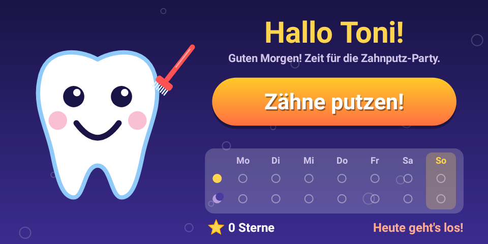
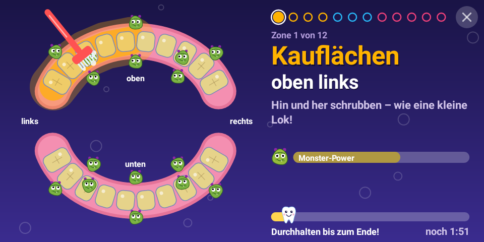
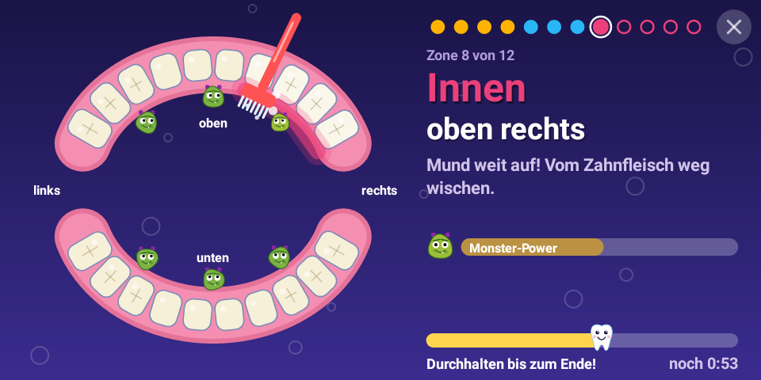

# Tonis Zahnputz-Party 🦷🎵

An Android app (German UI) that guides Toni through brushing his teeth, timed to the song
**"Zwei Minuten Party"**. Built for the **Echo Show 5** (960×480, landscape), and runs on any Android 5.1+ device.

| Start | Kauflächen | Innen |
|---|---|---|
|  |  |  |

## How it works

* A big **"Zähne putzen!"** button starts the song. The session lasts as long as the song (about 2 minutes).
* The screen shows both jaws seen like in a mirror (Toni's left = left side of the screen).
  The current zone glows, and an animated toothbrush moves along it **in time with the beat**:
  scrubbing back and forth on chewing surfaces, little circles on the outside, wiping on the inside.
* 12 zones in KAI order (**K**auflächen → **A**ußen → **I**nnen). Each lasts exactly 4 bars of the song (~8 s):
  1–4 Kauflächen oben links / oben rechts / unten rechts / unten links
  5–7 Außen links / vorne / rechts
  8–12 Innen oben rechts / oben links / unten links / unten rechts / vorne (Bürste hochkant)
  Then a finale (tongue) and "Ausspucken!".
* **Fun and motivation:**
  * Green **Zuckermonster** sit on every zone. While Toni brushes a zone, its monsters get scared and shrink until they go *Plopp!*
  * Teeth slowly change from yellowish to sparkling white, so he can see what's done and what's left.
  * A countdown "4-3-2-1-Los!" on the beat, a "Gleich: …" preview with a blinking arrow before each change, and a colour flash when the zone changes.
  * A "Monster-Power" bar per zone, and a little tooth riding along the song progress bar.
  * When the song ends: confetti, a star, and the total star count. The home screen shows a week chart
    (morning ☀ / evening ☾) and the streak of days in a row.
* Ending early: hold the **X** in the top right for 1.5 s (so a quick tap can't skip brushing). Back does nothing during a session.
  Only a full session earns a star.

## Adjusting the guidance to the song

The timing lives in `app/src/main/assets/timeline.json` (seconds from the start of the song). It was taken from
the song's beat grid (117.4 BPM; zones start at 7.79 s and switch every 8.18 s). If the lyrics call out
specific spots ("jetzt oben links…"), move `start`/`end` or change the order or texts there and rebuild.
Zone ids: `KAU_OL, KAU_OR, KAU_UR, KAU_UL, AUSSEN_L, AUSSEN_V, AUSSEN_R, INNEN_OL, INNEN_OR, INNEN_UL, INNEN_UR, INNEN_V`.

To use a different song, replace `app/src/main/res/raw/zwei_minuten_party.mp3` (same file name).

## Build

```bash
cd ToniZahnputz
./gradlew assembleRelease     # -> app/build/outputs/apk/release/app-release.apk
./gradlew testDebugUnitTest   # timeline check + screenshots in app/build/screenshots/
```

Needs JDK 17 and the Android SDK (platform 34). The GitHub Actions workflow `.github/workflows/toni-zahnputz.yml`
builds the APK on every push and attaches it as an artifact.

## Install on the device

With USB/ADB debugging enabled on the device:

```bash
adb connect <ip-of-device>:5555     # or USB
adb install -r app-release.apk
```

The release APK is signed with the debug key, so it can be sideloaded directly. If you build on a different
machine later, uninstall the old version first (the signature changes).
